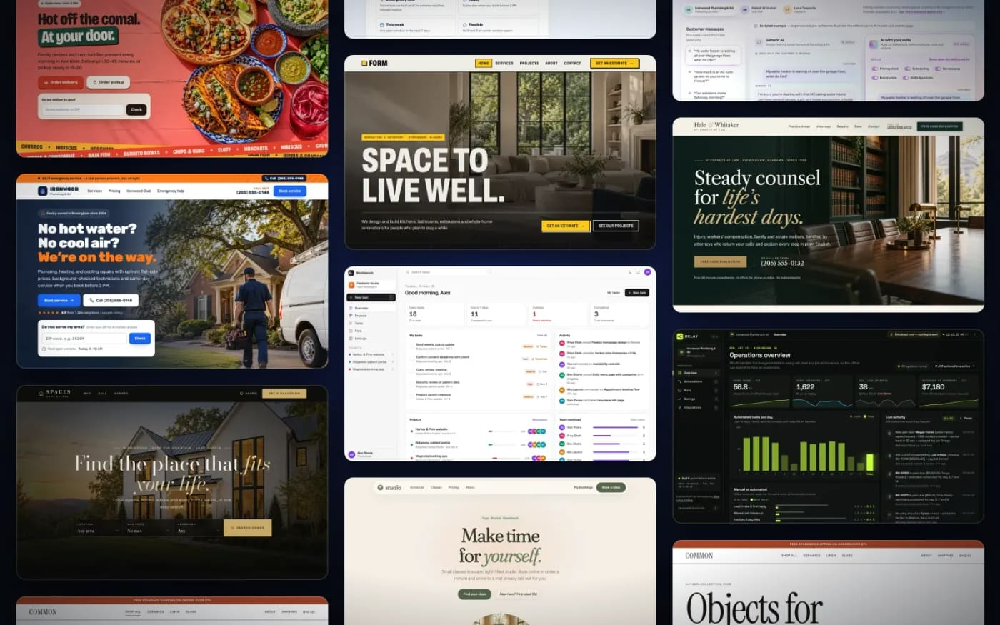
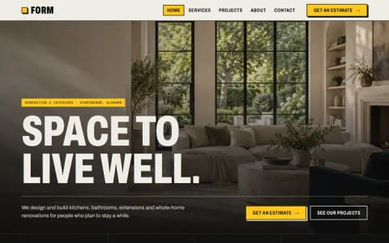
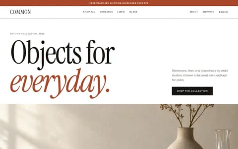
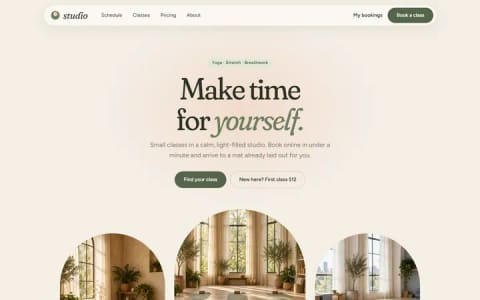
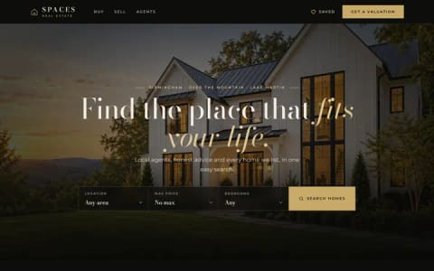
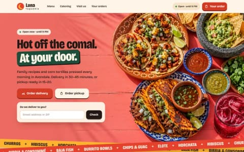
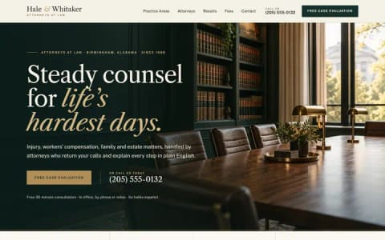
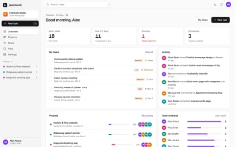
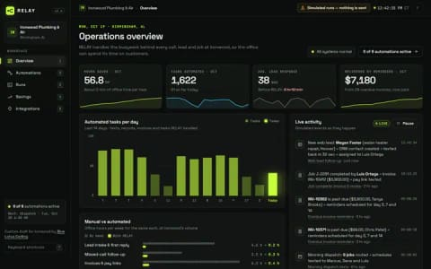
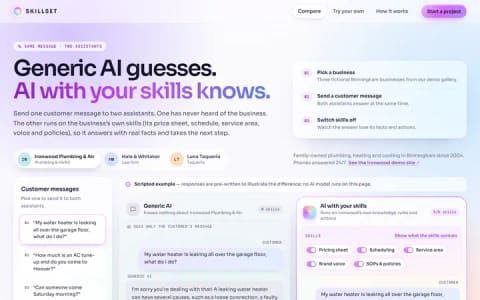

# Blue Lotus Coding · Demo gallery

**Live:** [demo.bluelotuscoding.com](https://demo.bluelotuscoding.com)



Ten complete, clickable demo sites, each for a different kind of business and each in its own design language. I show these to small-business owners instead of mockups. Each demo has a working core flow that runs in the browser, such as an estimate, a checkout, a class booking or a food order.

> Every business, person, price and address is fictional. Photos were generated with AI. The AI assistant's answers are scripted, and the page says so.

| | Demo | What it shows |
|---|---|---|
|  | **[FORM](https://demo.bluelotuscoding.com/form/)**<br>Renovation studio · bold industrial | Three-step estimate as the one clear next step |
|  | **[COMMON](https://demo.bluelotuscoding.com/common/)**<br>Homeware store · modern editorial | Slide-out bag, free-shipping bar, three-step checkout |
|  | **[STUDIO](https://demo.bluelotuscoding.com/studio/)**<br>Yoga studio · soft organic | Live two-week schedule with booking, class packs, rescheduling and cancellation |
|  | **[SPACES](https://demo.bluelotuscoding.com/spaces/)**<br>Real estate · dark luxury | Home search with filters and saved homes, photo lightbox, payment calculator, instant valuation |
|  | **[Luna](https://demo.bluelotuscoding.com/luna/)**<br>Taquería · bold playful | Dish customization, ZIP-checked delivery, fees, tax and tip, live order tracking |
|  | **[Hale & Whitaker](https://demo.bluelotuscoding.com/hale/)**<br>Law firm · classic authority | Fee estimator and a multi-step case evaluation that books a consultation |
|  | **[Ironwood](https://demo.bluelotuscoding.com/ironwood/)**<br>Plumbing & HVAC · rugged friendly | Service-area check, five-step booking with arrival windows, price estimator, technician tracker |
|  | **[Workbench](https://demo.bluelotuscoding.com/workbench/)**<br>Project management app · crisp product UI | Dashboard, drag-and-drop board, task details with checklists and comments, light and dark mode |
|  | **[RELAY](https://demo.bluelotuscoding.com/relay/)**<br>Business automation · technical console | Automations drawn as node graphs, with test runs, streaming logs, run history and an ROI calculator (runs are simulated) |
|  | **[Skillset](https://demo.bluelotuscoding.com/skillset/)**<br>AI assistant · aurora glass | A generic AI next to an AI running on the business's own skills, with skill toggles, citations and action cards |

## How it's built

- **No framework, no build step.** Plain HTML, CSS and vanilla JavaScript.
- **One folder per demo.** Each holds its own `index.html`, `styles.css`, `app.js` and `img/`, with a distinct type, colour and layout system.
- **A shared kit** in `shared/kit.js` and `shared/kit.css` provides:
  - hash routing;
  - storage that also works inside sandboxed previews;
  - formatting and form validation;
  - toasts and modals;
  - the "this is a demo" notice.
- **Saved state.** Carts, bookings and boards are kept in browser storage, so they survive a reload. Nothing is sent anywhere.
- **The gallery** (`index.html`, `gallery.js`, `gallery.css`) reads `manifest.json`. It shows each demo live in a scaled desktop or phone frame, which you can click into or open fullscreen.
- **Images** are WebP. The source PNGs are not in this repo.
- **Hosting:** deployed on Vercel with security headers and long cache headers for images (`vercel.json`).

## Run locally

```bash
node dev-server.mjs 5180
```

Then open http://localhost:5180/.

## About

Built by [Joshua Sajor](https://joshua-sajor-portfolio.vercel.app) for [Blue Lotus Coding](https://bluelotuscoding.com). The live deployment also hosts website studios made for real client businesses. Those aren't included here because they use the owners' own photos.

---

Code and design © 2026 Joshua Sajor / Blue Lotus Coding. Shared so you can see how it's built. Please don't republish the designs or images as your own.
